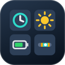

<p align="center">
  
</p>

<h1 align="center">Dashboard</h1>

<p align="center">
  A calm new tab: your time zones with day and night at each, plus local weather
  and device batteries.
</p>

<p align="center">
  Based on <a href="https://github.com/seanoliver/solstice"><strong>Solstice</strong></a> by Sean Oliver
</p>

<p align="center">
  
</p>

Dashboard replaces Chrome's new tab with a single, quiet world clock. A big
local time up top, a card for every place you care about, and a 24-hour
timeline that makes the whole day legible at once. Each clock is shaded by
where the sun actually is — so you can tell, without doing the math, who's
asleep, who's mid-morning, and who's wrapping up their day.

Beside the big clock sit the local weather and the battery levels of your
computer and, on macOS with an optional helper, your Bluetooth and Logitech
devices.

No accounts, no feeds, no clutter. Open a tab, get your bearings, move on.

> **Credit.** Dashboard is a fork of
> [Solstice](https://github.com/seanoliver/solstice), created by
> [Sean Oliver](https://github.com/seanoliver). The time zone cards, daylight
> bands, timeline scrubbing, edit panel, and the website are his work, and this
> project's git history keeps his commits. Dashboard adds local weather and
> battery panels on top. Sean isn't involved in this fork and isn't responsible
> for the changes made here. See [License](#license).

> **Read the [disclaimers](#disclaimers) before installing.** This fork asks for
> more access than the original and includes an optional helper that runs
> outside Chrome.

## Why you might like it

- **Glanceable.** One screen answers "what time is it for them, and is now a
  good time to ping?"
- **Day & night, for real.** Sunrise and sunset are computed for each city's
  coordinates, so the colored bands reflect the actual day — not a guess.
- **Yours in seconds.** Add or remove cities, drag to reorder, rename a zone
  to a person's name, flip the whole page between 12h and 24h.
- **Plan across zones.** Drag any timeline marker and every clock jumps to
  that moment — so you can find an hour that's civil for everyone.
- **Quiet by design.** Muted palette, monospace numerals, nothing blinking
  for your attention.

## Day & night at a glance

Every clock — the cards and the timeline — is banded by time of day, with the
light hours derived from real sunrise/sunset for that location:

- **Morning** — sunrise → 9am
- **Work** — 9am → 5pm
- **Evening** — 5pm → sunset
- **Night**

A dot marks "now" on each track, and the part of the day still ahead is dimmed
so the current moment reads instantly. Cities on a different calendar day get a
small `+1` / `−1` chip.

## Edit your zones

<p align="center">
  
</p>

Click **Edit** (bottom-right) to open the panel:

- **Drag** the `≡` handle to reorder — cards (left→right) and timeline
  (top→bottom) follow.
- **Rename** a zone by clicking its label (e.g. "Madrid" → "Steve").
- **Remove** with the `×` (in the panel or on the card).
- **Add** by searching — type a few letters and pick a match. Bundled cities
  resolve instantly; anything else falls back to a free geocoding lookup so
  you can add essentially any city on earth.

Your local card is anchored first and labels itself with your city
automatically. Don't like the guess? Type your own home label and it sticks.

A **12h / 24h** toggle in the top-right switches every time on the page at
once. Everything you change persists locally between tabs.

## Scrub to any moment

<p align="center">
  
</p>

Planning a call? Grab the marker on any timeline row and drag. The big local
clock, every card, and every other timeline jump to the same instant — so you
can read straight across: noon in San Francisco is 3pm in New York, 8pm in
London, tomorrow morning in Tokyo. Times snap to the quarter-hour as you go.

The page freezes while you explore, with a **⏸** pill up top showing the
moment you're parked at. Click it — or press **Esc** — to drop back to now.

## Weather

The big local clock has the current weather beside it: temperature, conditions,
feels-like, wind, humidity, and cloud cover. Click the temperature to switch
°C/°F (wind follows: mph or km/h). It defaults to °F for `en-US` browsers.

Weather comes from [Open-Meteo](https://open-meteo.com) for your local zone's
coordinates, rounded to about a kilometre, and refreshes every 30 minutes. If
the request fails, the panel simply doesn't show.

## Battery

A third column beside the weather lists batteries:

- **This device** — level, charging state, and time remaining, from Chrome's
  Battery Status API. This works in Chrome on any platform that reports a
  battery and stays local. A desktop with no battery may show a plugged-in 100%.
- **Bluetooth devices** (macOS, optional) — AirPods and their case, keyboards,
  mice, and similar.
- **Logitech devices on a USB receiver** (macOS, optional) — for example an
  MX Master mouse or MX Keys keyboard.

Chrome can't see anything but the computer it runs on, so the last two come from
a small helper that asks macOS and hands the result to the extension through
Chrome native messaging. It makes no network requests. Without it, only "This
device" shows.

### Install the helper (macOS)

Read [the disclaimers](#disclaimers) first; the helper is native code that
runs outside Chrome's sandbox.

1. Get the `native/` folder: clone the repo, or download it as a ZIP from
   [github.com/sougou/dashboard](https://github.com/sougou/dashboard).
2. From the repo folder, run:

   ```bash
   native/install.sh
   ```

   With no arguments this allows the private store listing (ID
   `akjlmhmbflomlldkmkmcfodacnijfkcl`). For an unpacked copy, pass its ID instead,
   shown on its **Details** page in `chrome://extensions`:

   ```bash
   native/install.sh <unpacked-extension-id>
   ```

   If you pass IDs, only those are allowed, so list every copy you use, including
   the store ID, to run both:

   ```bash
   native/install.sh akjlmhmbflomlldkmkmcfodacnijfkcl <unpacked-extension-id>
   ```
3. Reload the extension and open a new tab. Devices appear under "This device"
   and refresh every 5 minutes.

To update it, `git pull` and run the same command again. To remove it, run
`native/install.sh --uninstall`.

Notes:

- If Logi Options+ is installed, the helper reads the last battery level it
  saved for each device. That can lag the Options+ window, and Logitech may
  change the format in an update.
- macOS doesn't report charging state for these devices, so they have no
  charging indicator.
- Non-Mac computers get the extension, weather, and "This device" battery, but
  no helper.

## Disclaimers

Dashboard is a personal project, provided as is with no warranty, and is
distributed as a private extension. It is not affiliated with or endorsed by
Sean Oliver, Logitech, Apple, Open-Meteo, or any other company named here. It
is also more intrusive than a typical new-tab extension, so know what it does
before you install it:

- **It replaces your new tab page** and runs on every new tab you open.
- **Location.** It can ask for your browser's geolocation. If you allow it,
  your precise coordinates go to BigDataCloud to look up a city name. If you
  deny it, your IP address goes to ipwho.is, ipapi.co, or get.geojs.io instead.
- **Weather.** Your local zone's coordinates (rounded to about a kilometre) go
  to Open-Meteo every 30 minutes. Search text for city lookups goes to
  Open-Meteo too.
- **Battery.** "This device" uses Chrome's Battery Status API. It stays local.
- **Permissions.** `geolocation` and `nativeMessaging` (see `manifest.json`),
  and no host permissions. The page calls the services above directly. Chrome
  will warn about some of these.
- **The macOS helper is optional and is native code.** `native/install.sh`
  installs a Perl script that Chrome launches **outside its sandbox, with your
  user's privileges**. It reads connected Bluetooth devices and their
  batteries from `system_profiler` and `ioreg`, and, if Logi Options+ is
  installed, the last battery levels in its settings database. It makes no
  network requests and stores nothing, but you should read `native/` before
  running it. Only the extension IDs you pass to the installer may talk to it.
  Remove it with `native/install.sh --uninstall`.
- **Unofficial data sources.** The Logitech levels come from Logi Options+'s
  internal files and may be stale or stop working after an update. Nothing
  here is supported by Logitech or Apple.
- **Not for shared or managed machines.** This is meant for devices you own.
  Review [PRIVACY.md](PRIVACY.md) for the full data flow.

## Install

Dashboard is a private extension. It isn't listed publicly on the Chrome Web
Store; it's published as a private listing that only the people (Google
accounts) the publisher has added can install.

**From the private listing**

1. Sign in to Chrome with a Google account that has access to the listing.
2. Open the listing link you were given and click **Add to Chrome**. Chrome
   keeps it up to date automatically.
3. Open a new tab.
4. Optional, macOS only: [install the helper](#install-the-helper-macos) for
   Bluetooth and Logitech batteries.

**For development (unpacked)**

1. Clone the repo somewhere permanent. Chrome loads the extension straight from
   this folder, so don't move or delete it afterwards:

   ```bash
   git clone https://github.com/sougou/dashboard.git ~/dashboard
   ```

2. Open `chrome://extensions` and turn on **Developer mode** (top right). Leave
   it on: Chrome disables unpacked extensions while it's off.
3. Click **Load unpacked** and select the `~/dashboard` folder.
4. Open a new tab.

To update an unpacked copy, run `git -C ~/dashboard pull`, click the reload icon
on its card in `chrome://extensions`, and open a new tab. If `native/` changed,
re-run `native/install.sh <unpacked-extension-id>`.

An unpacked copy and the store copy have different extension IDs, and unpacked
IDs differ per computer. Only one extension can replace the new tab, so disable
the others, including the original Solstice.

## Configure defaults

The starting set of cities lives in `config.js`, but it's only the first-run
seed — once you edit zones in the UI, your choices (stored locally) take over.
To change the out-of-box defaults, edit the `ZONES` array:

```js
export const ZONES = [
  { label: "You",    tz: "local",         lat: 40.7128, lon: -74.0060 },
  { label: "London", tz: "Europe/London", lat: 51.5074, lon: -0.1278  },
];
```

Each entry has a `label`, an IANA `tz` (or `"local"` for the browser's own
timezone), and `lat`/`lon` used to compute sunrise/sunset. Array order is the
display order; the `"local"` zone always renders first.

## Privacy

The extension has no servers, no accounts, no analytics, no tracking, and the
developer receives nothing. Your settings live in your browser. It does contact
a few third-party services, described in [PRIVACY.md](PRIVACY.md) and summarised
under [Disclaimers](#disclaimers): location (if you allow it) goes to
BigDataCloud, or your IP address goes to an IP lookup service; rounded
coordinates go to Open-Meteo for weather; city search text goes to Open-Meteo.
The detected city and coordinates are cached locally for 24 hours. The optional
macOS helper reads Bluetooth and Logi Options+ battery data locally and makes no
network requests. The website source in `web/` runs the same new tab, stores its
settings in that site's `localStorage`, and never detects your location.

## Development

The extension has no build step — it uses vanilla ES modules. Run its unit
tests (time model, sun math, day-part bands, weather, battery, Bluetooth
parsing) with:

```bash
node --test
```

The public website is an isolated Astro project:

```bash
cd web
pnpm install
pnpm dev       # local server
pnpm check     # Astro and TypeScript diagnostics
pnpm build     # static output in web/dist/
```

Project layout:

- `manifest.json` — MV3 manifest; overrides the new-tab page.
- `newtab.html` / `newtab.css` / `newtab.js` — page, styles, app wiring.
- `config.js` — first-run default zones. `cities.js` — bundled city dataset.
- `src/` — `timeModel.js`, `sun.js` (sunrise/sunset), `bands.js`,
  `dayPart.js`, `zones.js` (storage), `geo.js` (location), `layout.js`
  (responsive grid), `cityLookup.js` (remote search), `weather.js`,
  `battery.js`, `bluetooth.js` (native-helper client and parsers), `render.js`.
- `native/` — optional macOS helper (`dashboard-bluetooth-host`) and its
  `install.sh`. `tools/make-icons.swift` regenerates the icons (macOS).
- `test/` — `node:test` unit suites. `web/` — Astro website.
- `docs/` — durable project memory, design notes, and roadmap.

Contributions welcome — see [docs/ROADMAP.md](docs/ROADMAP.md) for ideas.

## License

[MIT](LICENSE). Copyright © 2026 Sean Oliver (original Solstice) and © 2026
Sugu Sougoumarane (Dashboard changes). The MIT license requires keeping both
notices.
